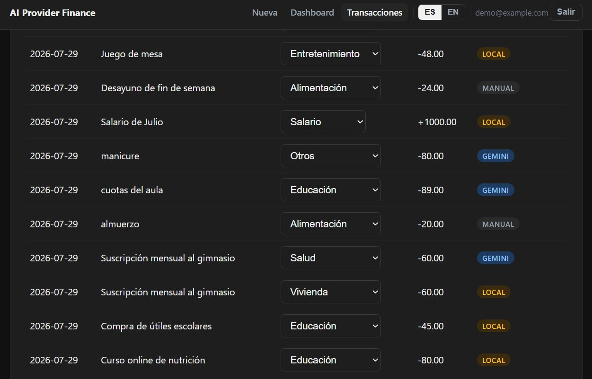

# Patrón de Abstracción de Proveedor de IA — Gestor de Finanzas Personales

[](https://github.com/ArkonysDevJ/nestjs-ai-provider-finance/blob/main/README.md)
[](https://github.com/ArkonysDevJ/nestjs-ai-provider-finance/blob/main/README.es.md)

> **TL;DR:** Una arquitectura de proveedor de IA intercambiable para aplicaciones backend, demostrada a través de un rastreador de finanzas personales con categorización automática de transacciones.



## El patrón

La mayoría de los tutoriales conectan un backend de IA directamente a la lógica de la aplicación — un solo proveedor, un solo SDK, fuertemente acoplados. Este proyecto invierte eso: el dominio (finanzas personales) es el ejemplo, no el punto central. El punto es una interfaz `AIProvider` limpia que permite intercambiar el modelo subyacente sin tocar la lógica de negocio.

```
AI_PROVIDER=gemini   → GeminiProvider   (producción)
AI_PROVIDER=local    → LocalProvider    (desarrollo, cliente MCP real sobre hardware local)
```

Ambas implementaciones satisfacen el mismo contrato. Cambiar de proveedor es una sola variable de entorno — sin cambios de código, sin redeploy de la lógica de negocio.

**La prueba empírica no es solo arquitectónica — está en los datos.** Cada transacción persiste qué proveedor la categorizó (campo `ai_provider`), así que la abstracción no es solo una afirmación de diseño en el papel; es verificable por cada fila en la base de datos.

## Por qué importa

Los SDKs de IA cambian rápido, los modelos de precios varían y los límites de uso difieren por proveedor. Una aplicación cuya lógica central depende de la librería cliente de un solo proveedor hereda directamente las caídas, cambios de precio y breaking changes de la API de ese proveedor. Este patrón trata al proveedor de IA como infraestructura — intercambiable, testeable de forma aislada, y reemplazable sin tocar la capa de dominio.

## Stack

- **Backend:** NestJS
- **Base de datos / Auth:** Supabase (PostgreSQL + Auth)
- **Frontend:** React
- **IA:** Google Gemini API (producción) / modelo local vía FastMCP (desarrollo)

## Arquitectura

Monorepo con npm workspaces — backend y frontend son hermanos simétricos, no un añadido pegado sobre la API:

```
apps/
├── api/                                   # Backend NestJS
│   └── src/
│       ├── ai/
│       │   ├── ai-provider.interface.ts   # El contrato que ambas implementaciones satisfacen
│       │   ├── gemini.provider.ts         # Implementación de producción
│       │   ├── local.provider.ts          # Implementación de desarrollo (cliente MCP real)
│       │   └── ai-provider.factory.ts     # Resuelve el proveedor activo desde env
│       ├── transactions/
│       │   ├── transactions.module.ts
│       │   ├── transactions.service.ts    # Llama a AIProvider, persiste el campo ai_provider
│       │   └── entities/transaction.entity.ts
│       ├── categories/
│       └── common/guards/                 # Guard estándar de JWT de Supabase (sin vendor lock-in)
└── web/                                   # Dashboard React + Vite
    └── src/

supabase/migrations/                       # Esquema SQL, aplicado vía Supabase CLI
bruno/                                     # Colección de API, probada contra un proyecto Supabase real
finance-classifier-mcp/                    # Servidor MCP de referencia que respalda AI_PROVIDER=local
                                           # (Python + Ollama; MCP real sobre streamable-http,
                                           # no un mock REST plano)
```

## Cómo empezar

Requiere Node 24.22.1+ (ver `.nvmrc`). Este es un monorepo con npm workspaces — un solo `npm install` en la raíz instala ambas apps.

```bash
npm install

# apps/api/.env  (copiar desde apps/api/.env.example)
SUPABASE_URL=https://your-project.supabase.co
SUPABASE_ANON_KEY=your-anon-or-publishable-key
AI_PROVIDER=gemini            # o "local" para el proveedor de desarrollo FastMCP
GEMINI_API_KEY=your-gemini-api-key

# apps/web/.env  (copiar desde apps/web/.env.example)
VITE_SUPABASE_URL=https://your-project.supabase.co
VITE_SUPABASE_ANON_KEY=your-anon-or-publishable-key
VITE_API_URL=http://localhost:3000/v1
```

Aplica el esquema vía Supabase CLI (sin pasos manuales en el editor SQL):

```bash
npx supabase login
npx supabase link --project-ref your-project-ref
npx supabase db push
```

Esto ejecuta todo lo que hay en `supabase/migrations/` (seed de categorías + transacciones + políticas RLS) contra tu proyecto vinculado. `npx supabase migration list` muestra qué está aplicado.

```bash
npm run dev:api    # NestJS en :3000
npm run dev:web    # Vite en :5173
```

Para correr con `AI_PROVIDER=local` en vez de Gemini, `finance-classifier-mcp/` es un servidor MCP real (streamable-http, no un mock REST) respaldado por un modelo Ollama local:

```bash
cd finance-classifier-mcp
python -m venv venv && venv\Scripts\activate   # o source venv/bin/activate en Linux/Mac
pip install -r requirements.txt
python server.py    # sirve http://0.0.0.0:8765/mcp
```

Requiere [Ollama](https://ollama.com/) corriendo localmente con un modelo descargado (por defecto: `qwen2.5:3b`). Configura `LOCAL_AI_ENDPOINT=http://localhost:8765/mcp` en `apps/api/.env`, y luego corre `npm run dev:api:local` en vez de `dev:api` — sobreescribe `AI_PROVIDER` para ese proceso sin tocar el `.env` (también existe un `dev:api:gemini` equivalente, para volver atrás sin editar archivos).

**GPUs con poca VRAM (4GB o menos):** `finance-classifier-mcp` limita `num_ctx` a 2048 en su petición a Ollama. La razón es bien concreta: en una GTX 1650 (4GB), cargar `qwen2.5:3b` me falló una vez con `cudaMalloc failed: out of memory`, incluso sin nada más ocupando la GPU. En el siguiente intento funcionó, pero cambié dos cosas a la vez — confirmar que Ollama podía cargar el modelo directo vía `ollama run`, *y* agregar el límite de `num_ctx` — así que no puedo aislar cuál de las dos lo arregló realmente. De todos modos el límite no cuesta nada (la clasificación casi no necesita contexto), así que lo dejo como una precaución razonable, no como una corrección de causa raíz confirmada. Si te topas con el mismo OOM en otro hardware, revisa el uso de VRAM con `nvidia-smi` o el Administrador de Tareas — y no des por hecho que el límite, por sí solo, te va a salvar.

## API

Todos los endpoints requieren `Authorization: Bearer <supabase-jwt>` y viven bajo `/v1`.

| Método | Ruta                          | Descripción                                      |
|--------|-------------------------------|---------------------------------------------------|
| GET    | `/categories?type=expense\|income` | El catálogo fijo (11 categorías en total), opcionalmente filtrado por el tipo de transacción aplicable |
| POST   | `/transactions`                | Crea una transacción; la IA la clasifica en línea, desde la lista de categorías aplicable a su tipo |
| GET    | `/transactions`                | Lista las transacciones del usuario autenticado          |
| POST   | `/transactions/:id/reclassify` | Override manual; limpia `ai_classified`/`ai_provider`; rechaza una categoría cuyo `applies_to` no coincide con el tipo de la transacción (400) |
| GET    | `/transactions/summary?month=YYYY-MM` | `byCategory` acotado a ese mes (por defecto: mes actual); `byMonth` es la serie histórica completa, sin acotar |

El catálogo de categorías es consciente del tipo (`applies_to`: `expense` \| `income` \| `both`, ver `supabase/migrations/003_category_types.sql`): 7 categorías de gasto, 3 categorías de ingreso (Salario, Ingreso extra, Reembolso), y "Otros" como fallback universal para cualquiera de los dos. Esto no es cosmético — está reforzado en ambos lados: el prompt de IA solo ofrece las categorías válidas para el tipo de la transacción (`categoryNamesForType()` en `ai-provider.interface.ts`), y `POST /transactions/:id/reclassify` rechaza una categoría no coincidente del lado del servidor incluso si un cliente evita el filtro de la UI.

**Rate limiting en `POST /transactions`:** 20 peticiones / 5 minutos por usuario autenticado (`UserThrottlerGuard`), más un límite separado de 100 peticiones / 5 minutos por IP en toda la API (`ThrottlerGuard` global, `AppModule`). Dos capas independientes, no redundantes: el límite por usuario existe porque este endpoint llama al proveedor de IA en cada petición — Gemini en producción, un costo directo por request — y la cuenta más expuesta a esto es el login de la demo pública de arriba, no solo un caso teórico de abuso. Rastrear por `user.id` en vez de por IP evita penalizar a usuarios legítimos detrás de un NAT/proxy compartido, pero un límite solo por usuario se resetea a cero para cada cuenta recién creada (el registro es self-service, directo contra Supabase Auth, sin gate en este backend) — la capa por IP cierra ese bypass específico acotando la IP de origen sin importar cuántas cuentas autentique. Verificado end-to-end: 21 llamadas consecutivas a `POST /transactions` contra la cuenta demo, la petición 21 devolvió `429` con un mensaje traducido y legible en la UI (`transactionForm.rateLimited`) en vez del cuerpo crudo de la respuesta del backend.

## Testing

Una colección de [Bruno](https://www.usebruno.com/) vive en `bruno/nestjs-ai-provider-finance/`, corrida contra un proyecto Supabase real en vez de mocks — `01 - Sign In` autentica directamente contra Supabase Auth, el resto de las peticiones llevan ese token contra la API local. Los nombres de archivo numerados (`01-`, `02-`...) hacen explícito el orden de ejecución dentro de cada carpeta, sin orden implícito que adivinar.

**Aislamiento de RLS, verificado independientemente de la capa de aplicación:** `security-tests/01-direct-rls-cross-user-empty.bru` y `02-direct-rls-own-user-visible.bru` evitan el backend de NestJS por completo y consultan la API PostgREST de Supabase directamente con el JWT de un usuario real — probando que `transactions_select_own` (la política RLS en `20260728120000_001_init_schema.sql`) hace el aislamiento por sí sola, independientemente de cualquier cosa que el backend pueda agregar encima. `01` prueba que el usuario A obtiene un resultado vacío al consultar las transacciones del usuario B (`200 []`, no un 401/403 — RLS filtra las filas silenciosamente en vez de rechazar la petición); `02` es el control de cordura, la misma forma, las propias transacciones del usuario A, confirmando que el camino no está simplemente denegando a todo el mundo.

Una suite pgTAP separada (`supabase/tests/database/`) ejercita la misma superficie de RLS a nivel SQL, independiente tanto del backend como de HTTP: lecturas cross-user denegadas, suplantación de `user_id` de otro usuario en insert/update/delete denegada, y el catálogo de categorías compartido confirmado como genuinamente público (control, no un falso "todo está bloqueado"). Se corre vía `npx supabase start` (stack local de Docker) y luego `npx supabase test db` — nunca toca el proyecto remoto.

Tanto `FORCE ROW LEVEL SECURITY` (cerrando el bypass del dueño de la tabla) como esta capa completa de tests negativos/adversariales se agregaron después de que una auditoría de seguridad inicial encontró que la suite de tests original solo cubría el happy path — una brecha real, cerrada en vez de dejada como deuda aceptada en un proyecto de portafolio que busca demostrar exactamente este tipo de rigor.

## Gemini vs. local — una comparación real, no una afirmación

7 intentos vía `AI_PROVIDER=local` contra una GTX 1650 + Ollama real: 2 fallaron por infraestructura (una conexión rechazada porque Ollama no estaba corriendo, luego un OOM de VRAM — ambos diagnosticados y documentados arriba, ninguno un bug de código), 5 produjeron clasificaciones reales de punta a punta a través del servidor MCP.

El dato más claro: la misma transacción exacta, corrida por ambos proveedores una tras otra.

| Descripción | Gemini | Local (qwen2.5:3b) |
|---|---|---|
| "Suscripción mensual al gimnasio" | Salud | Vivienda |

Mismo input, dos respuestas distintas — ambas individualmente defendibles — persistidas por fila vía `ai_provider`. El modelo local se enganchó con el patrón "mensual"/factura recurrente (el mismo patrón que correctamente clasifica "Pago mensual de línea móvil" como Vivienda) en vez de analizar el sujeto. Eso no es un bug que arreglar; es el trade-off real y medido de calidad entre una API de producción y un modelo de 3B corriendo en una tarjeta de 4GB — que es todo el punto de persistir `ai_provider`: puedes verlo en los datos, no solo tomarlo como un acto de fe.

Otras clasificaciones locales observadas: "Cita pediátrica" → Salud, "Uber al hospital" → Transporte (priorizó el viaje sobre el propósito del destino), "Curso online de nutrición" → Educación (priorizó el formato sobre el tema), "Compra de útiles escolares" → Educación.

## Qué demuestra este proyecto

- Diseño guiado por interfaces para una dependencia volátil (proveedores de IA)
- Inyección de dependencias basada en variables de entorno sin un workaround de framework de DI
- Verificación empírica y respaldada por datos de una afirmación arquitectónica (no solo una aseveración de README)
- Una aplicación funcional y testeable (backend, frontend, y tests de API contra una base de datos real) — no solo un ejercicio de diseño
- Ambos proveedores verificados de punta a punta contra infraestructura real (API de Gemini y un modelo Ollama local a través de un servidor MCP real, no un stub REST) — ver "Gemini vs. local" arriba para el trade-off de calidad medido, no solo la afirmación arquitectónica
- Aislamiento de RLS probado independientemente en dos capas por debajo de la aplicación: peticiones directas a PostgREST con un JWT real (evitando el backend por completo) y una suite pgTAP a nivel SQL — ambas cubriendo lecturas cross-user, suplantación de autoría en insert/update/delete, y un control positivo para que "aislado" no se confunda con "todo denegado". `FORCE ROW LEVEL SECURITY` cierra el bypass del dueño de la tabla en cada tabla. Ver "Testing" arriba.
- Localización completa de la UI en ES/EN (`react-i18next`) con un selector de idioma visible, la elección persistida en `localStorage`. **El español es el default, el inglés es el toggle opcional** — esta es una decisión deliberada, no un descuido: el mercado inicial real de este proyecto es Latinoamérica, así que la UI por defecto usa el idioma que hablan sus primeros usuarios reales. Las 8 categorías de transacción y los valores de `ai_provider` nunca se traducen — son datos de dominio persistidos/comparados, no copy de UI.

## Demo en vivo

**Frontend:** https://nestjs-ai-provider-finance-web.vercel.app

**Backend:** https://nestjs-ai-provider-finance-production.up.railway.app

Credenciales demo (cuenta de solo lectura, sin datos reales):

- Email: `demo@arkonysdevj.com`
- Password: `arkonys2026`

## Decisiones de despliegue

**Node 24 queda fijado** (`engines: >=24.22.1`, `.nvmrc`, `.node-version`) porque 24.22.1 es la primera versión 24.x con las [correcciones de seguridad de octubre de 2026](https://nodejs.org/en/blog/vulnerability/october-2026-security-releases). El backend lo compila Nixpacks (`railway.json`), que elige una versión de Node por su cuenta cuando el repositorio no declara ninguna.

**Por qué Docker.** El `Dockerfile` de la raíz construye la API en una imagen cuyo runtime de Node es la etiqueta base (`node:24.22.1-slim`), y no la versión que el builder resuelva en cada despliegue. Solo lleva la API compilada y sus dependencias de producción; el clasificador MCP en Python sigue siendo un servicio aparte, al que se llega por `LOCAL_AI_ENDPOINT`. Se construye con `docker build .` desde la raíz del repositorio.

| | Railway | Cloud Run |
|---|---|---|
| Costo con poco tráfico | El contenedor se cobra mientras corre, es decir, todo el tiempo salvo que se active el modo de suspensión | Escala a cero; el tiempo inactivo no se cobra |
| Arranque en frío | Ninguno por defecto: la instancia sigue activa | La primera petición tras un periodo inactivo espera a que arranque una instancia, salvo que se mantenga un mínimo de instancias |
| Autenticación | URL pública; el acceso lo controla la app (guard con JWT de Supabase y límite de peticiones) | Pública, o restringida por la plataforma a llamadas autenticadas con IAM |
| Cómo se fija la versión de Node | Nixpacks lee `engines` / `.nvmrc`; con el builder Dockerfile, la etiqueta de la imagen base | La etiqueta de la imagen base de la imagen desplegada (los despliegues desde código usan buildpacks que leen `engines`) |
| Quién compila la imagen | Railway, ejecutando en cada despliegue el build definido en `railway.json` | Uno mismo o el CI (o Cloud Build), subiéndola a un registro |

Este repositorio despliega el backend en Railway con Nixpacks, según `railway.json`; el Dockerfile queda listo para cuando se cambie el builder, y entonces la versión de Node vendrá de la imagen y no de Nixpacks.

**Contrato de la imagen:** escucha en `PORT` (3000 si no está definido) en `0.0.0.0`, no guarda estado local salvo los contadores del límite de peticiones en memoria (por instancia, se reinician al reiniciar; los datos están en Supabase), escribe los logs en stdout/stderr y se cierra de forma ordenada con `SIGTERM`.

## Estado

✅ Desplegado — julio 2026. Backend en Railway, frontend en Vercel. Ambos caminos de `AI_PROVIDER` (Gemini y local/MCP) verificados de punta a punta. Ver "Demo en vivo" arriba para las credenciales.

✅ Auditoría de seguridad — agosto 2026. Una revisión independiente encontró que la suite de tests original solo cubría el happy path, sin cobertura negativa/adversarial. Cerrado: se agregó `FORCE ROW LEVEL SECURITY` en `categories`/`transactions`, se probó el aislamiento cross-user de RLS tanto vía peticiones directas a PostgREST (evitando el backend) como con una suite pgTAP a nivel SQL, se eliminó un flag `credentials: true` de CORS que estaba muerto (el frontend de este proyecto usa exclusivamente Bearer tokens, nunca cookies, así que el flag no tenía efecto pero era confuso dejarlo), y se limitó `POST /transactions` por usuario y por IP para acotar el gasto en la API de Gemini (ver "API" arriba). Verificado de punta a punta, incluyendo el bypass de cuenta recién creada en un límite ingenuo solo-por-usuario.

## Licencia

MIT
