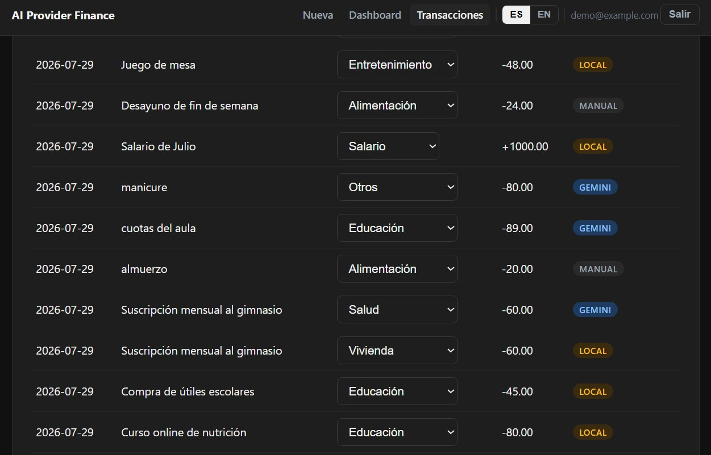

# AI Provider Abstraction Pattern — Personal Finance Tracker

[](https://github.com/ArkonysDevJ/nestjs-ai-provider-finance/blob/main/README.md)
[](https://github.com/ArkonysDevJ/nestjs-ai-provider-finance/blob/main/README.es.md)

> **TL;DR:** A swappable AI provider architecture for backend applications, demonstrated through a personal finance tracker with automatic transaction categorization.



## The Pattern

Most tutorials wire an AI backend directly into application logic — one provider, one SDK, tightly coupled. This project inverts that: the domain (personal finance) is the example, not the point. The point is a clean `AIProvider` interface that lets the underlying model be swapped without touching business logic.

```
AI_PROVIDER=gemini   → GeminiProvider   (production)
AI_PROVIDER=local    → LocalProvider    (development, real MCP client over local hardware)
```

Both implementations satisfy the same contract. Switching providers is a single environment variable — no code change, no redeploy of business logic.

**The empirical proof isn't just architectural — it's in the data.** Every transaction persists which provider categorized it (`ai_provider` field), so the abstraction isn't just a design claim on paper; it's verifiable per row in the database.

## Why this matters

AI SDKs change fast, pricing models shift, and rate limits vary by provider. An application whose core logic depends on one vendor's client library inherits that vendor's outages, pricing changes, and API breaking changes directly. This pattern treats the AI provider as infrastructure — interchangeable, testable in isolation, and swappable without touching the domain layer.

## Stack

- **Backend:** NestJS
- **Database / Auth:** Supabase (PostgreSQL + Auth)
- **Frontend:** React
- **AI:** Google Gemini API (production) / local model via FastMCP (development)

## Architecture

npm workspaces monorepo — backend and frontend are symmetric siblings, not an afterthought bolted onto the API:

```
apps/
├── api/                                   # NestJS backend (ES modules, Fastify)
│   ├── src/
│   │   ├── ai/
│   │   │   ├── ai-provider.interface.ts   # The port and the result: ai or fallback with a reason
│   │   │   ├── config.ts                  # Reads and validates the provider settings
│   │   │   ├── classification.ts          # Exact-match parser, timeout, error to reason
│   │   │   ├── gemini.provider.ts         # Production implementation
│   │   │   ├── gemini.sdk-client.ts       # Adapter of the Gemini SDK
│   │   │   ├── local.provider.ts          # Development implementation
│   │   │   ├── local.mcp-client.ts        # Adapter of the real MCP client
│   │   │   └── ai.module.ts               # The one place that selects the provider
│   │   ├── transactions/                  # Controller, service, DTOs
│   │   ├── categories/
│   │   ├── health/                        # GET /v1/health, for the monitor and keep-alive
│   │   └── common/
│   │       ├── guards/                    # Supabase JWT guard and the per-user limit
│   │       ├── decorators/
│   │       └── errors/                    # mapBackendError and the retry of reads
│   ├── test/                              # Policy tests and the fake MCP server
│   └── deploy/                            # Cloud Run service definition and setup runbook
└── web/                                   # React + Vite dashboard
    └── src/lib/                           # API client, money and paging modules

supabase/
├── migrations/                            # Schema history, applied by the maintainer
└── tests/database/                        # pgTAP tests (isolation, privileges, constraints)
bruno/                                     # HTTP collection, run in CI against a local Supabase stack
scripts/                                   # Acceptance-criteria coverage, migration data checks
specs/                                     # One folder per change: spec, plan, tasks
finance-classifier-mcp/                    # Reference MCP server backing AI_PROVIDER=local
                                           # (Python + Ollama; real MCP over streamable-http,
                                           # not a plain REST mock)
```

How the pieces fit, and why, is in [ARCHITECTURE.md](ARCHITECTURE.md).

## Getting started

Requires Node 24.22.1+ (see `.nvmrc`). This is an npm workspaces monorepo — one `npm install` at the root installs both apps.

```bash
npm install

# apps/api/.env  (copy from apps/api/.env.example)
SUPABASE_URL=https://your-project.supabase.co
SUPABASE_ANON_KEY=your-anon-or-publishable-key
AI_PROVIDER=gemini            # or "local" for the FastMCP dev provider
GEMINI_API_KEY=your-gemini-api-key
GEMINI_MODEL=your-gemini-model-name   # exact name; a "-latest" alias is rejected at startup
CORS_ORIGINS=http://localhost:5173    # origins that may call the API from a browser; none if missing

# apps/web/.env  (copy from apps/web/.env.example)
VITE_SUPABASE_URL=https://your-project.supabase.co
VITE_SUPABASE_ANON_KEY=your-anon-or-publishable-key
VITE_API_URL=http://localhost:3000/v1
```

Apply the schema via the Supabase CLI (no manual SQL editor step):

```bash
npx supabase login
npx supabase link --project-ref your-project-ref
npx supabase db push
```

This runs everything in `supabase/migrations/` (categories seed + transactions + RLS policies) against your linked project. `npx supabase migration list` shows what's applied.

```bash
npm run dev:api    # NestJS on :3000
npm run dev:web    # Vite on :5173
```

To run with `AI_PROVIDER=local` instead of Gemini, `finance-classifier-mcp/` is a real MCP server (streamable-http, not a REST mock) backed by a local Ollama model:

```bash
cd finance-classifier-mcp
python -m venv venv && venv\Scripts\activate   # or source venv/bin/activate
pip install -r requirements.txt
python server.py    # serves http://0.0.0.0:8765/mcp
```

Requires [Ollama](https://ollama.com/) running locally with a model pulled (default: `qwen2.5:3b`). Set `LOCAL_AI_ENDPOINT=http://localhost:8765/mcp` in `apps/api/.env`, then run `npm run dev:api:local` instead of `dev:api` — it overrides `AI_PROVIDER` for that process without touching `.env` (there's a `dev:api:gemini` counterpart too, for switching back without editing files).

**VRAM-constrained GPUs (4GB and under):** `finance-classifier-mcp` caps `num_ctx` to 2048 in its Ollama request. Context: on a GTX 1650 (4GB), loading `qwen2.5:3b` failed once with `cudaMalloc failed: out of memory` even with nothing else on the GPU. It worked on the next attempt, after both confirming Ollama could load the model via `ollama run` directly *and* adding the `num_ctx` cap — those two things happened together, so which one actually fixed it isn't isolated. The cap costs nothing either way (classification needs almost no context) and is kept as a reasonable precaution, not a confirmed root-cause fix. If you hit the same OOM on other hardware, check `nvidia-smi` / Task Manager for VRAM usage — and don't assume the cap alone will save you.

## API

All endpoints require `Authorization: Bearer <supabase-jwt>` and live under `/v1`.

| Method | Path                          | Description                                      |
|--------|-------------------------------|---------------------------------------------------|
| GET    | `/categories?type=expense\|income` | The fixed catalog (11 categories total), optionally filtered to what applies to that transaction type |
| POST   | `/transactions`                | Create a transaction; AI classifies it inline, from the category list applicable to its type |
| GET    | `/transactions?limit=&offset=` | List the authenticated user's transactions, newest first, in pages (`limit` 1 to 200, default 100; `offset` 0 or more); a total order (date, creation time, id) keeps the pages stable |
| POST   | `/transactions/:id/reclassify` | Manual override: the database marks the transaction as manual and clears `ai_classified`, `ai_provider` and `ai_model`; rejects a category whose `applies_to` doesn't match the transaction's type (400). Naming the category the transaction already has is an explicit no-op, not a reclassification: its classification stays as it was |
| GET    | `/transactions/summary?month=YYYY-MM` | `byCategory` scoped to that month (default: current month); `byMonth` is the full historical series, unscoped. Computed by a database function, so it is exact to the cent whatever the number of rows; `totalExpense` and `totalIncome` are decimal strings (`"1234.50"`) and `transactionCount` is a number |

The category catalog is type-aware (`applies_to`: `expense` \| `income` \| `both`, see `supabase/migrations/003_category_types.sql`): 7 expense categories, 3 income categories (Salario, Ingreso extra, Reembolso), and "Otros" as the universal fallback for either. This isn't cosmetic — it's enforced on both sides: the AI prompt only offers the categories valid for the transaction's type (`categoryNamesForType()` in `ai-provider.interface.ts`), and `POST /transactions/:id/reclassify` rejects a mismatched category server-side even if a client bypasses the UI filter.

**Rate limiting:** two independent layers. A limiter of the project's own runs first, before authentication, and counts the requests of each client address in a fixed window, in memory and per instance (the counters start again with each instance); `/v1/health` has its own, higher threshold, so the uptime monitor is never limited by the traffic of the API. The thresholds are set in `apps/api/deploy/service.yaml`. Behind Cloud Run every client reaches the service through the platform proxy, so the address is read from `X-Forwarded-For` counting from the right: with one proxy in front (`RATE_LIMIT_TRUSTED_PROXY_HOPS=1`) it is the last entry, which the proxy wrote, and the entries to its left, written by the client, are ignored. If any of the four `RATE_LIMIT_*` variables is missing the limiter is inactive and the application says so at startup. The second layer is 20 requests / 5 minutes per authenticated user on `POST /transactions` (`UserThrottlerGuard`): this endpoint calls the AI provider on every call — Gemini in production, a direct per-request cost — and the account most exposed to it is the public demo login above, not just a theoretical abuse case. Tracking by `user.id` rather than IP avoids penalizing legitimate users behind a shared NAT/proxy, but a per-user limit alone resets to zero for every freshly created account, so the per-address layer bounds the requests of one address across all the accounts it uses. It does not stop the creation of accounts: signup is self-service, directly against Supabase Auth, and does not go through this backend. Exceeding either limit returns `429` with a `Retry-After` header. Verified end-to-end: 21 consecutive `POST /transactions` calls against the demo account, request 21 returned `429` with a translated, human-readable message in the UI (`transactionForm.rateLimited`) instead of the raw backend response body.

## Testing

A [Bruno](https://www.usebruno.com/) collection lives in `bruno/nestjs-ai-provider-finance/`, run against a real Supabase project rather than mocks — `01 - Sign In` authenticates directly against Supabase Auth, the rest of the requests carry that token against the local API. Numbered filenames (`01-`, `02-`...) make run order explicit within each folder, no implicit ordering to guess.

**RLS isolation, verified independently of the application layer:** `security-tests/01-direct-rls-cross-user-empty.bru` and `02-direct-rls-own-user-visible.bru` bypass the NestJS backend entirely and query Supabase's PostgREST API directly with a real user's JWT — proving `transactions_select_own` (the RLS policy in `20260728120000_001_init_schema.sql`) does the isolating on its own, independent of anything the backend might add on top. `01` proves user A gets an empty result querying user B's transactions (`200 []`, not a 401/403 — RLS silently filters rows rather than rejecting the request); `02` is the sanity control, same shape, user A's own transactions, confirming the path isn't just denying everyone.

A separate pgTAP suite (`supabase/tests/database/`) exercises the same RLS surface at the SQL level, independent of both the backend and HTTP: cross-user reads denied, insert/update/delete spoofing of another user's `user_id` denied, and the shared category catalog confirmed genuinely public (control, not a false "everything's blocked" result). Run via `npx supabase start` (local Docker stack) then `npx supabase test db` — never touches the remote project.

Both `FORCE ROW LEVEL SECURITY` (closing the table-owner bypass) and this full negative/adversarial test layer were added after an initial security audit found the original test suite covered only the happy path — a real gap, closed rather than left as accepted debt in a portfolio project meant to demonstrate exactly this kind of rigor.

**Data guarantees and known limits.** The database enforces the data rules, not only the API: a positive `amount`, a category that applies to the transaction type, and a classification state (`classification_status`, `classification_reason` and `ai_model`) that a client cannot edit directly. Client roles can insert and read their own transactions and update `category_id` only; there is no `DELETE` privilege and no delete endpoint, so rows are removed only by the maintainer from the SQL editor.

- **Provenance is declared by the API, not verified by the database.** The provider and the model of a classification are written by the API at creation. A client with direct access to the database API could insert a well-formed but false provenance; the database rejects malformed ones, and a test documents this limit.
- **The public demo exposes its data.** The demo credentials are public, so anyone who signs in can read and change the demo's transactions. A database trigger rejects changes to the demo account's password, e-mail and phone. Do not enter real data in the demo.
- **Reclassifying to the same category changes nothing.** The manual state is derived only when the category really changes, so a request that names the category a transaction already has is an explicit no-op, not a reclassification: its classification stays as it was.

**Known limit of the database privileges.** The migrations revoke every privilege that the client roles do not need and set default privileges so that new objects in `public` start with none. They cannot change the default privileges of the platform role `supabase_admin`, because the migration role is not a member of it. An object created by that role can therefore start with privileges for the client roles. The mitigation is a check after every migration applied to the hosted project: the grants of `public` are compared with the intended matrix, and any privilege outside it stops the rollout (`apps/api/deploy/RUNBOOK-SETUP.md`, section 14).

## Gemini vs. local — a real comparison, not a claim

7 attempts through `AI_PROVIDER=local` against a live GTX 1650 + Ollama setup: 2 failed on infrastructure (a connection refused because Ollama wasn't running, then a VRAM OOM — both diagnosed and documented above, neither a code bug), 5 produced real classifications end-to-end through the MCP server.

The clearest data point: the exact same transaction, run through both providers back to back.

| Description | Gemini | Local (qwen2.5:3b) |
|---|---|---|
| "Suscripción mensual al gimnasio" | Salud | Vivienda |

Same input, two different — both individually defensible — answers, persisted per-row via `ai_provider`. The local model latched onto "mensual"/recurring-bill phrasing (the same pattern that correctly classifies "Pago mensual de línea móvil" as Vivienda) instead of parsing the subject. That's not a bug to fix; it's the actual, measured quality trade-off between a production API and a 3B model running on a 4GB card — which is the whole point of persisting `ai_provider`: you can see this in the data, not just take it on faith.

Other local classifications observed: "Cita pediátrica" → Salud, "Uber al hospital" → Transporte (prioritized the ride over the destination's purpose), "Curso online de nutrición" → Educación (prioritized the format over the topic), "Compra de útiles escolares" → Educación.

## What this project demonstrates

- Interface-driven design for a volatile dependency (AI providers)
- Environment-based dependency injection without a DI framework workaround
- Empirical, data-backed verification of an architectural claim (not just a README assertion)
- A working, testable application (backend, frontend, and API tests against a real database) — not just a design exercise
- Both providers verified end-to-end against real infrastructure (Gemini API and a local Ollama model through a real MCP server, not a REST stub) — see "Gemini vs. local" above for the measured quality trade-off, not just the architectural claim
- RLS isolation proven independently at two layers below the application: direct PostgREST requests with a real JWT (bypassing the backend entirely) and a pgTAP suite at the SQL level — both covering cross-user reads, insert/update/delete authorship spoofing, and a positive control so "isolated" isn't confused with "everything denied". `FORCE ROW LEVEL SECURITY` closes the table-owner bypass on every table. See "Testing" above.
- Full ES/EN UI localization (`react-i18next`) with a visible language switcher, choice persisted in `localStorage`. **Spanish is the default, English is the opt-in toggle** — this is a deliberate choice, not an oversight: this project's real initial market is Latin America, so the UI defaults to the language its actual first users speak. The 8 transaction categories and the `ai_provider` values are never translated — they're persisted/compared domain data, not UI copy.

## Live demo

**Frontend:** https://nestjs-ai-provider-finance-web.vercel.app

**Backend:** https://ai-finance-api-834290807468.southamerica-east1.run.app

Demo credentials (read-only account, no real data):

- Email: `demo@arkonysdevj.com`
- Password: `arkonys2026`

## Deployment decisions

**Node 24 is pinned** (`engines: >=24.22.1`, `.nvmrc`, `.node-version`) because 24.22.1 is the first 24.x release with the [October 2026 security fixes](https://nodejs.org/en/blog/vulnerability/october-2026-security-releases). The Docker base image carries the same exact version.

**Why Docker.** The root `Dockerfile` builds the API into an image whose Node runtime is the base tag (`node:24.22.1-slim`), not whatever version a builder resolves on a given deploy. It ships only the compiled API and its production dependencies; the Python MCP classifier stays a separate service reached through `LOCAL_AI_ENDPOINT`. Build it with `docker build .` from the repository root.

**Where it runs.** The API runs on Google Cloud Run in `southamerica-east1` (São Paulo). It scales between 0 and 2 instances: idle time is not billed, and the first request after a quiet period waits for an instance to start (cold start). CPU is allocated only while a request is being handled, and a request is cut after 60 seconds.

**Configuration and secrets.** The service is described in `apps/api/deploy/service.yaml`, with a marker where the image goes. The Gemini key and the Supabase publishable key live in Secret Manager and are read at a pinned version (never `latest`), so rotating a key is a deployment. The one-time Google Cloud setup is documented in `apps/api/deploy/RUNBOOK-SETUP.md`.

**How it is deployed.** The CI workflow (`.github/workflows/ci.yml`) builds the API, the web app and the image on every pull request and every push to `main`. The deploy workflow (`.github/workflows/deploy.yml`) runs only after CI succeeds for a push to `main`: it builds that exact commit, publishes the image and deploys it by digest. It authenticates with Workload Identity Federation (no key files exist) and never commits or pushes. `main` only accepts changes through pull requests.

**Keep-alive.** The free-tier Supabase project pauses after about 7 days without activity, so `/v1/health` (which calls the database function `public.ping()`) is requested regularly: by an external uptime monitor, which is the primary mechanism, and by `.github/workflows/keep-alive.yml` every 2 days as a backup. GitHub disables scheduled workflows in a public repository after 60 days without repository activity, and that workflow does not commit anything to prevent it, so it can stop silently after that time; the external monitor keeps working.

**Image contract:** listens on `PORT` (3000 if unset) on `0.0.0.0`, keeps no local state other than in-memory rate-limit counters (per instance, reset on restart; data lives in Supabase), logs to stdout/stderr, and shuts down cleanly on `SIGTERM`.

## Status

✅ Deployed — July 2026. Backend on Google Cloud Run (moved from Railway in November 2026), frontend on Vercel. Both `AI_PROVIDER` paths (Gemini and local/MCP) verified end-to-end. See "Live demo" above for credentials.

✅ Security audit — August 2026. Independent review found the original test suite covered only the happy path, with no negative/adversarial coverage. Closed: `FORCE ROW LEVEL SECURITY` added on `categories`/`transactions`, RLS cross-user isolation proven both via direct PostgREST requests (bypassing the backend) and a pgTAP suite at the SQL level, a dead `credentials: true` CORS flag removed (this project's frontend uses Bearer tokens exclusively, never cookies, so the flag had no effect but was misleading to leave in place), and `POST /transactions` rate-limited per-user and per-IP to bound Gemini API spend (see "API" above). Verified end-to-end, including the freshly-created-account bypass on a naive per-user-only limit.

## License

Apache License 2.0 — see [LICENSE](./LICENSE) and [NOTICE](./NOTICE).
